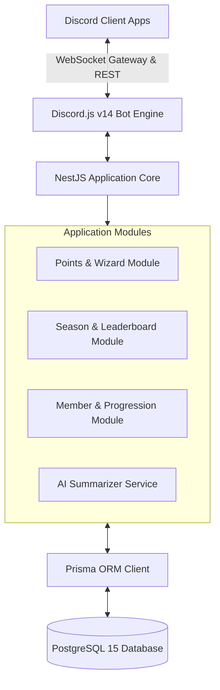
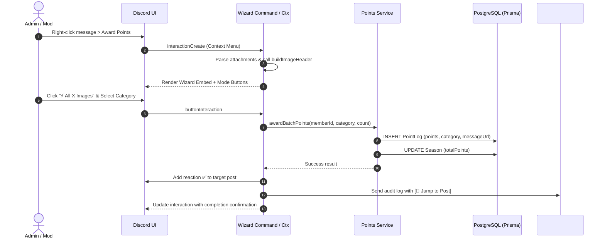

# DARKSTAR CLAN MANAGEMENT SYSTEM (EWLYA)
## Report 4 – Software Design Document
*Ho Chi Minh City, September 2026*

---

## Table of Contents
- [I. Record of Changes](#i-record-of-changes)
- [II. Software Design Document](#ii-software-design-document)
  - [1. System Design](#1-system-design)
    - [1.1 System Architecture](#11-system-architecture)
    - [1.2 Package Diagram](#12-package-diagram)
  - [2. Database Design](#2-database-design)
    - [2.1 Design Conventions](#21-design-conventions)
    - [2.2 Subject Areas](#22-subject-areas)
    - [2.3 Table Descriptions](#23-table-descriptions)
  - [3. Detailed Design](#3-detailed-design)
    - [3.1 Point Wizard & Batch Scoring Workflow](#31-point-wizard--batch-scoring-workflow)
    - [3.2 Leaderboard Rendering Workflow](#32-leaderboard-rendering-workflow)
    - [3.3 Season Rollover & Archiving Workflow](#33-season-rollover--archiving-workflow)
    - [3.4 Member Progression & Birthday Scheduler Workflow](#34-member-progression--birthday-scheduler-workflow)

---

## I. Record of Changes

| Date | A* M, D | In charge | Change Description |
| :--- | :---: | :--- | :--- |
| **15/07/2026** | A | DarkStar Dev Team | Initial architecture design, NestJS modular layout, and Prisma database schema. |
| **05/08/2026** | M | DarkStar Dev Team | Designed Smart Point Wizard component interaction, safe header capping algorithms, and podium embed renderer. |
| **12/08/2026** | M | DarkStar Dev Team | Detailed state machine for multi-category image tracking and season transition sequence diagrams. |
| **12/09/2026** | M | DarkStar Dev Team | Refined Docker multi-container service mapping, PgBouncer pooler config, and production deployment layout. |

*\*A - Added, M - Modified, D - Deleted*

---

## II. Software Design Document

### 1. System Design

#### 1.1 System Architecture
EWLYA adopts a multi-tier modular architecture orchestrating three core services inside a single Docker Compose deployment environment:
1. **Discord Bot Gateway (Discord.js v14)**: Listens to Discord WebSocket gateway events, processes interactions, and handles button/modal/command callbacks.
2. **NestJS Application Core**: Houses business logic modules, dependency injection containers, and transactional services.
3. **PostgreSQL Relational Database**: Managed via Prisma ORM for type-safe relational data access with connection pooling.

| Layer Name | Technology / Runtime | Responsibilities |
| :--- | :--- | :--- |
| **Discord Client Layer** | Discord Desktop / Web / Mobile | User interaction surface (Slash commands, Context menus, Modals, Buttons) |
| **Bot Gateway Layer** | Discord.js v14 Gateway Client | Event dispatching, rate limit handling, interaction routing |
| **Application Service Layer** | NestJS v10 Modules | `PointService`, `SeasonService`, `MemberService`, `AISummaryService` |
| **Persistence Layer** | Prisma ORM Client | Type-safe SQL query compilation, transactional boundary enforcement |
| **Database Layer** | PostgreSQL 15 Container | Relational storage for members, seasons, point logs, configurations |

#### 1.2 Package Diagram

##### 1.2.1 Backend Core Modules (`src/modules/`)
- `points.module.ts`: `PointsService`, point calculation, and category configuration.
- `seasons.module.ts`: `SeasonService`, season state transitions, and archive generation.
- `members.module.ts`: `MemberService`, `BirthdayService`, and progression checker.

##### 1.2.2 Discord Bot Layer (`src/bot/`)
- `commands/`: 23 slash & context menu commands (`wizard`, `leaderboard`, `season`, `birthday`, `award-points-ctx`...).
- `events/`: Gateway handlers (`interactionCreate`, `messageReactionAdd`, `guildMemberAdd`).
- `services/`: Bot-specific presentation helpers (`sync-helper`, `embed-builder`, `ai-summary`).

##### 1.2.3 Database & ORM Layer (`prisma/` & `src/database/`)
- Prisma client singleton, schema definitions, and migration scripts.

---

### 2. Database Design

#### 2.1 Design Conventions
All tables use UUID v4 or Snowflake IDs as primary keys, adhere to `snake_case` column naming in SQL with `camelCase` mappings in TypeScript, and maintain strict `createdAt` / `updatedAt` audit timestamps.

#### 2.2 Subject Areas
| Subject Area | Included Tables | Description & Scope |
| :--- | :--- | :--- |
| **Identity & Clan Membership** | `Member`, `MemberRole`, `BirthdayProfile` | Stores Discord member IDs, guild nicknames, roles, and birthdays. |
| **Seasons & Competitions** | `Season`, `SeasonLeaderboardSnapshot` | Tracks monthly competition windows, status flags, and final standings. |
| **Points & Audit Logs** | `PointLog`, `PointCategory`, `SubmissionAudit` | Stores every scoring transaction with points, category, moderator ID, and message URL. |
| **System Configuration** | `GuildConfig`, `ChannelMapping` | Stores guild-level channel IDs (`#log-points`, `#announcements`) and admin role IDs. |

#### 2.3 Table Descriptions
| Table Name | Key Columns & Constraints | Purpose & Relationships |
| :--- | :--- | :--- |
| **Member** | `id` (PK), `discordId` (Unique), `username`, `nickname`, `joinedAt`, `isActive` | Clan member identity master record. |
| **Season** | `id` (PK), `name`, `startDate`, `endDate`, `isActive`, `totalPointsAwarded` | Competition season tracking active and archived states. |
| **PointLog** | `id` (PK), `memberId` (FK), `seasonId` (FK), `points`, `category`, `messageUrl`, `modId`, `createdAt` | Immutable point audit entries with clickable jump links. |
| **BirthdayProfile** | `id` (PK), `memberId` (FK), `birthMonth`, `birthDay`, `lastAnnouncedYear` | Member birthday registration and celebration tracking. |

---

### 3. Detailed Design

#### 3.1 Point Wizard & Batch Scoring Workflow

#### 3.2 Leaderboard Rendering Workflow
1. **Slash Command**: User runs `/leaderboard [season]`.
2. **Query Aggregation**: System aggregates `sum(points)` grouped by `memberId` for target season, ordered `DESC`.
3. **Podium Construction**: Top 3 contestants receive custom medal podium blocks (🥇, 🥈, 🥉) with formatted score badges.
4. **Rank Formatting**: Ranks 4 to 10 rendered as structured numbered list (`#04`, `#05`...).
5. **Embed Dispatch**: Neon Cyan themed embed sent with footer stats (total points awarded, contestant count).

#### 3.3 Season Rollover & Archiving Workflow
1. Admin triggers `/season close`.
2. System sets current season `isActive = false`.
3. Generates immutable snapshot of final member standings in `SeasonLeaderboardSnapshot` table.
4. Prompts admin to open next month's season via `/season create`.
5. Autocomplete in `/leaderboard` immediately exposes the archived season for historical viewing.

#### 3.4 Member Progression & Birthday Scheduler Workflow
1. **Daily Cron Trigger**: Scheduled task runs at 00:00 UTC daily.
2. **Birthday Scan**: Queries `BirthdayProfile` matching current day and month.
3. **Announcement Embed**: Dispatches celebration embed in designated announcement channel and updates `lastAnnouncedYear`.
4. **Progression Check**: Verifies member tenure milestones and notifies leadership for role upgrades.

---
*— End of Report 4: Software Design Document —*
