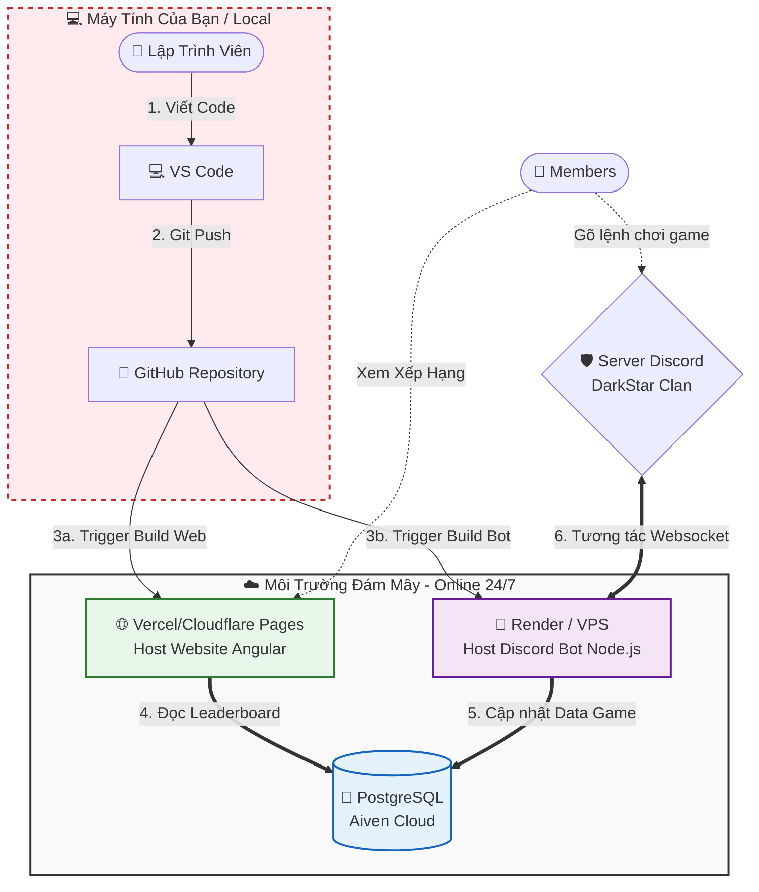

# 🏗️ DarkStar Clan - System Architecture Overview

Tài liệu này mô tả sơ đồ triển khai và quy trình vận hành hệ thống DarkStar. Đảm bảo toàn bộ hệ thống Web và Bot Discord hoạt động liên tục 24/7 trên môi trường Đám Mây (Cloud), độc lập hoàn toàn với máy tính cá nhân của Lập trình viên.

## 1. Sơ Đồ Kiến Trúc Hệ Thống (System Architecture Diagram)

*Lưu ý: Notion hỗ trợ hiển thị trực tiếp sơ đồ này. Bạn hãy copy phần code bên dưới bỏ vào Block `/mermaid` trên Notion.*

---

## 2. Các Thành Phần Công Nghệ (Tech Stack)

Hệ thống được chia làm 3 thành phần vi dịch vụ (Micro-services) bảo mật và tách biệt:

| Tên Dịch Vụ | Công Nghệ Áp Dụng | Nền tảng Cloud (Đề xuất) | Trạng Thái |
| :--- | :--- | :--- | :--- |
| **Frontend (Website)** | Angular 20, Tailwind CSS 4, DaisyUI | Vercel / Cloudflare Pages | Online 24/7 (Serverless) |
| **Backend (Discord Bot)** | Node.js, TypeScript, Discord.js | Render / VPS Linux | Online 24/7 (Background Worker) |
| **Database** | PostgreSQL, Prisma ORM | Aiven.io / Neon.tech | Online 24/7 (Managed DB) |

---

## 3. Quy Trình Vận Hành (Workflow)

Đây là vòng đời mượt mà của dự án khi Hệ thống đã đi vào hoạt động ổn định:

1. **🏡 Môi trường Local (Phát triển tính năng)**: 
   - Lập trình viên khởi động máy tính, code tính năng (Ví dụ: Thêm hàm xếp hạng mới cho Bot). Dữ liệu lúc này kết nối với DB ảo ở Local để không làm hỏng Data trên mạng.
2. **🚀 Triển khai Mã Nguồn (Deployment)**: 
   - Code xong, Lập trình viên dùng lệnh `git push` để đẩy kho chứa mã nguồn lên môi trường GitHub.
   - Lúc này, Máy tính cá nhân có thể **TẮT HOÀN TOÀN**. Phần việc còn lại Máy chủ đám mây sẽ tiếp quản.
3. **⚙️ CI/CD Tự Động Hóa (Automation)**:
   - Các ông lớn như Vercel và Render liên tục nấp bóng theo dõi GitHub. Ngay khi có lệnh Push mới ở nhánh Main, Vercel tự động xây dựng lại Giao diện Website, và Render tự động khởi động lại Con Bot. 
   - Không xuất hiện thời gian Web/Bot bị sập nhờ cơ chế Zero-Downtime.
4. **🔄 Đồng Bộ Hóa Dữ Liệu Thực (Live Data)**:
   - Cả Vercel (Front) và Render (Bot) đều chỏ ống hút Database của nó về chung cái "Bể chứa" là Aiven Cloud (PostgreSQL). Nhờ đó, bất cứ con quái vật nào Membear đánh hay điểm nào thu được thông qua Bot Discord ban đêm, thì Website Sáng hôm sau đều hiển thị chính xác y xì đúc trên Bảng Xếp Hạng.

---

## 4. Tác Vụ Lập Lịch (Scheduled Tasks / Cron Jobs)

Hệ thống sử dụng `@nestjs/schedule` để tự động hóa các quy trình vận hành bảo trì:

| Tên Tác Vụ | Tần Suất | Mục Đích |
| :--- | :--- | :--- |
| **Trash Cleanup** | Hàng ngày (00:00) | Xóa vĩnh viễn các đợt check đã nằm trong thùng rác > 30 ngày. |
| **Discord Report** | Hàng ngày (09:00) | Quét các đợt check mới kết thúc và gửi báo cáo danh sách Red Flag (chưa hoàn thành) vào Discord. |

*Lưu ý: Các tác vụ này chạy ngầm trên Backend (Render/Vercel Server) và không phụ thuộc vào việc người dùng có truy cập web hay không.*
