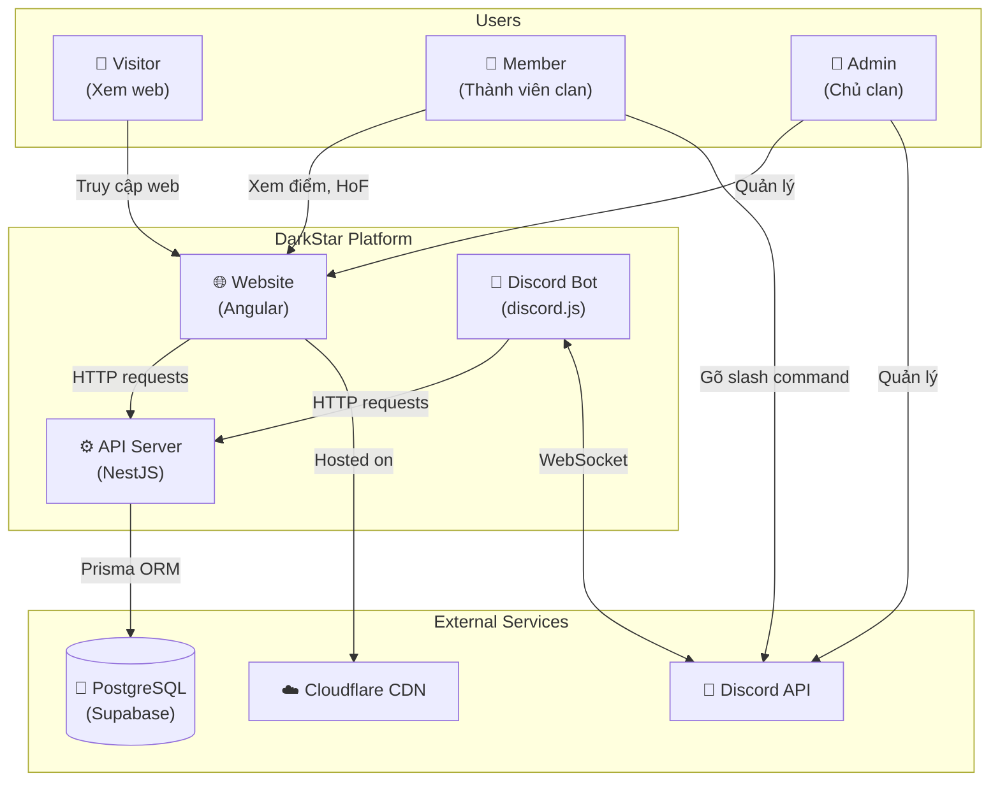
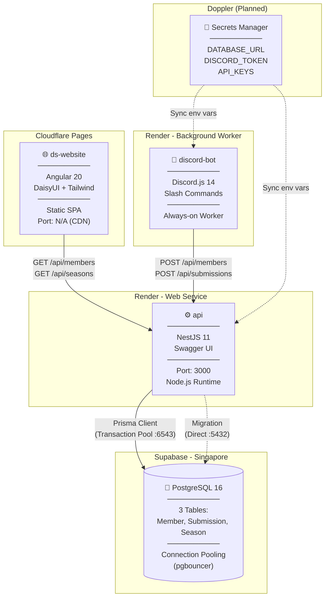
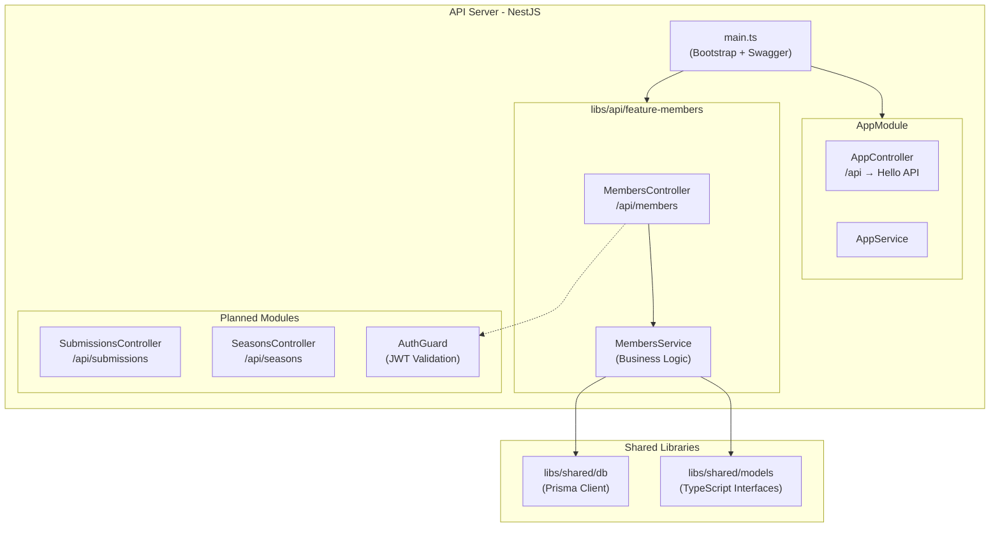
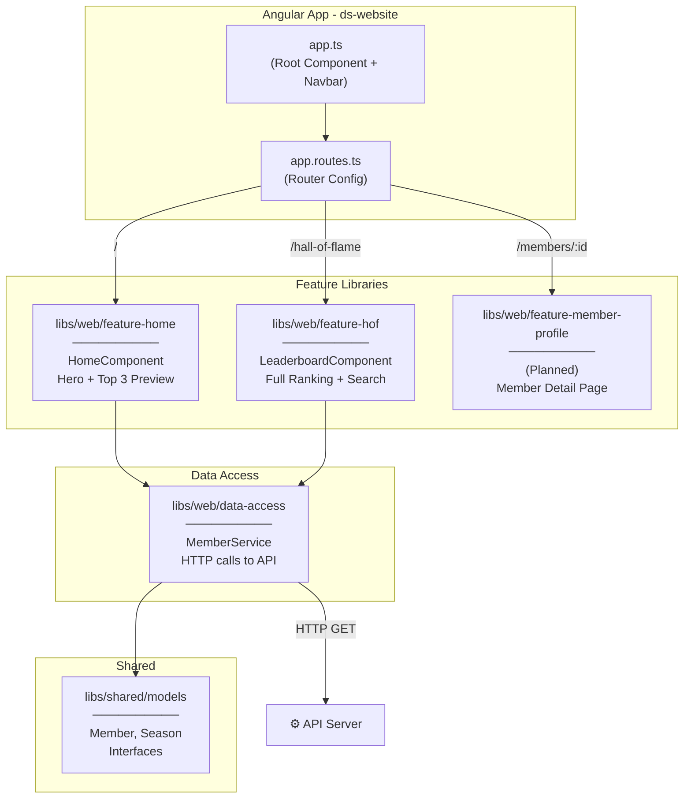
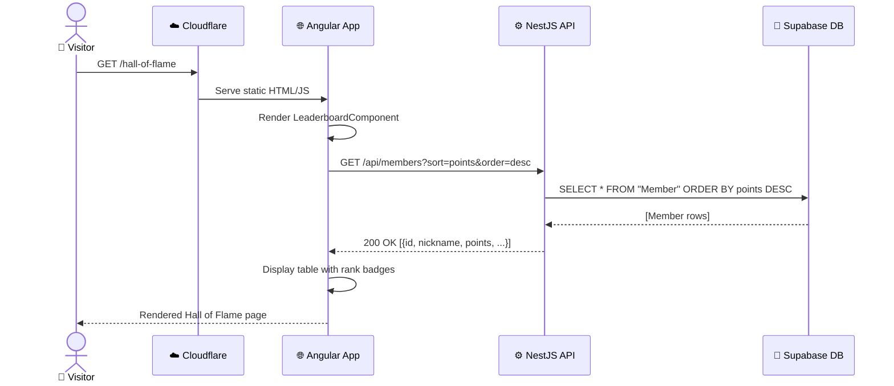
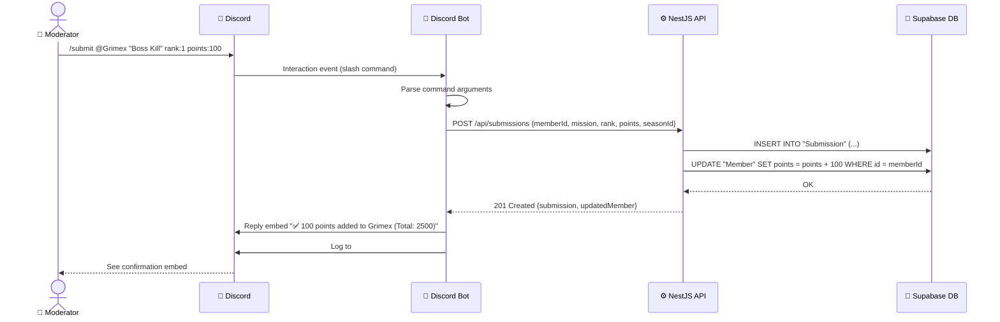
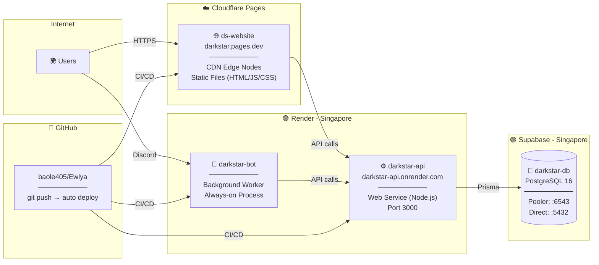
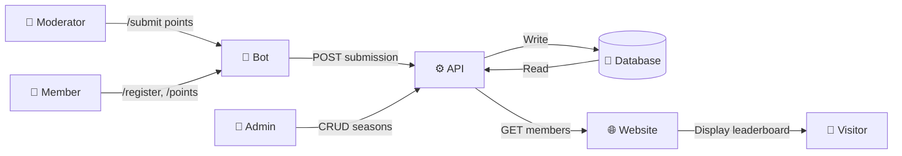

# 🏗️ System Diagrams — DarkStar Platform

> Tài liệu này chứa các sơ đồ kỹ thuật mô tả cách hệ thống DarkStar vận hành.
> Sử dụng **C4 Model** (Context → Container → Component) và **Sequence Diagrams**.

---

## 1. System Context Diagram (C4 Level 1)

> *"Ai sử dụng hệ thống và hệ thống kết nối với gì?"*

---

## 2. Container Diagram (C4 Level 2)

> *"Hệ thống gồm những 'hộp' nào, mỗi hộp chạy ở đâu?"*

---

## 3. Component Diagram (C4 Level 3) — API Server

> *"Bên trong cái hộp API có gì?"*

---

## 4. Component Diagram (C4 Level 3) — Website

> *"Bên trong cái hộp Website có gì?"*

---

## 5. Sequence Diagram — User Xem Bảng Xếp Hạng

> *"Khi user mở trang Hall of Flame, chuyện gì xảy ra từng bước?"*

---

## 6. Sequence Diagram — Mod Submit Điểm Qua Bot

> *"Khi Moderator gõ /submit trên Discord, flow đi như thế nào?"*

---

## 7. Deployment Diagram

> *"Cái gì được deploy ở đâu? Dùng domain / port nào?"*

---

## 8. Data Flow Diagram (DFD Level 0)

> *"Dữ liệu chảy từ đâu đến đâu?"*

---

*Tất cả sơ đồ sử dụng Mermaid.js — render trực tiếp trên GitHub, Notion, và VS Code.*
*Cập nhật lần cuối: 2026-04-05*
